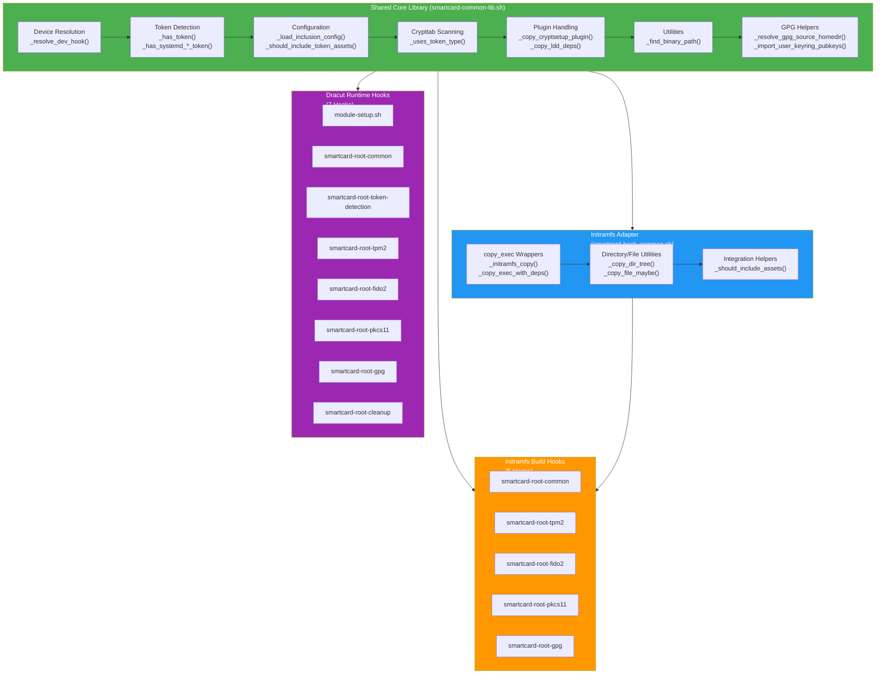
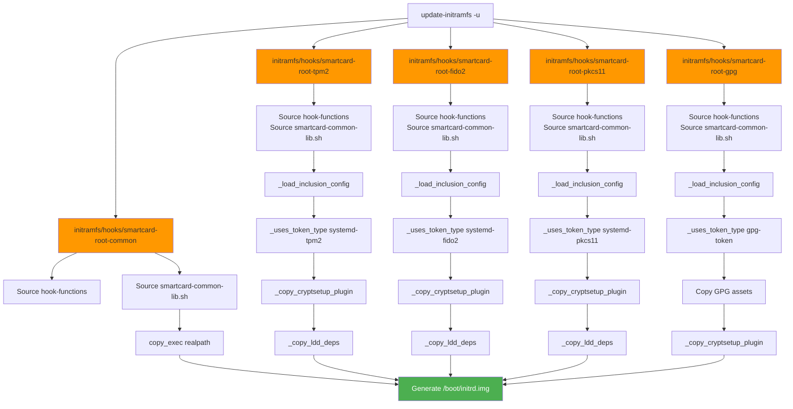
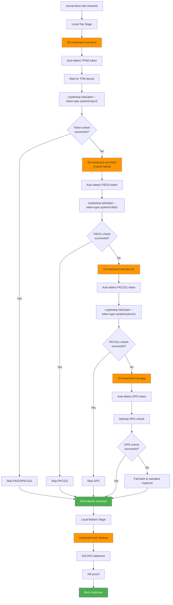
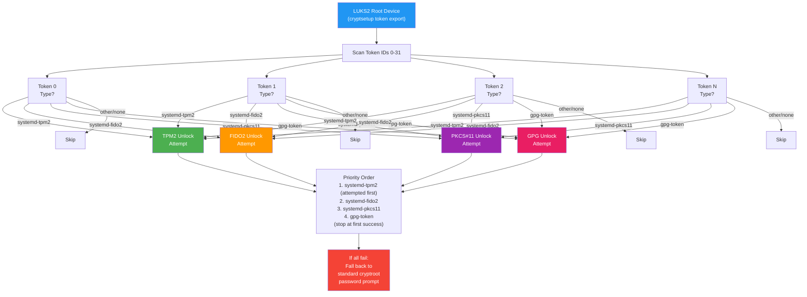
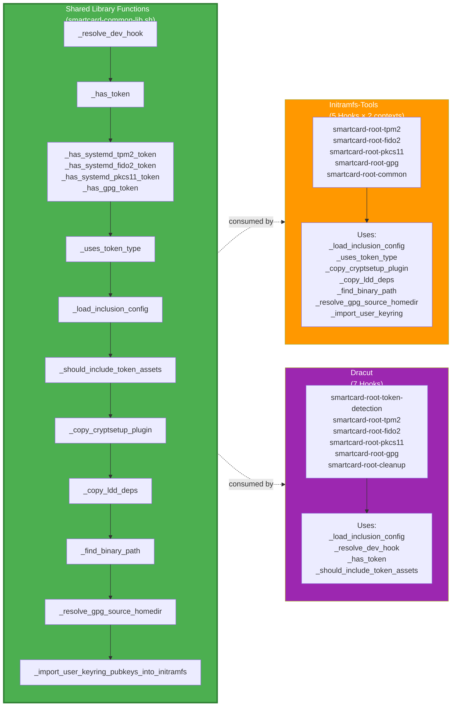
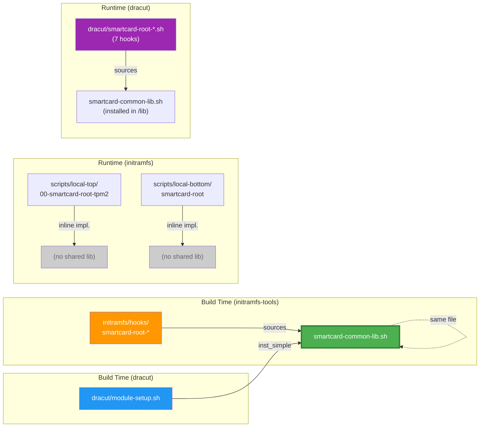
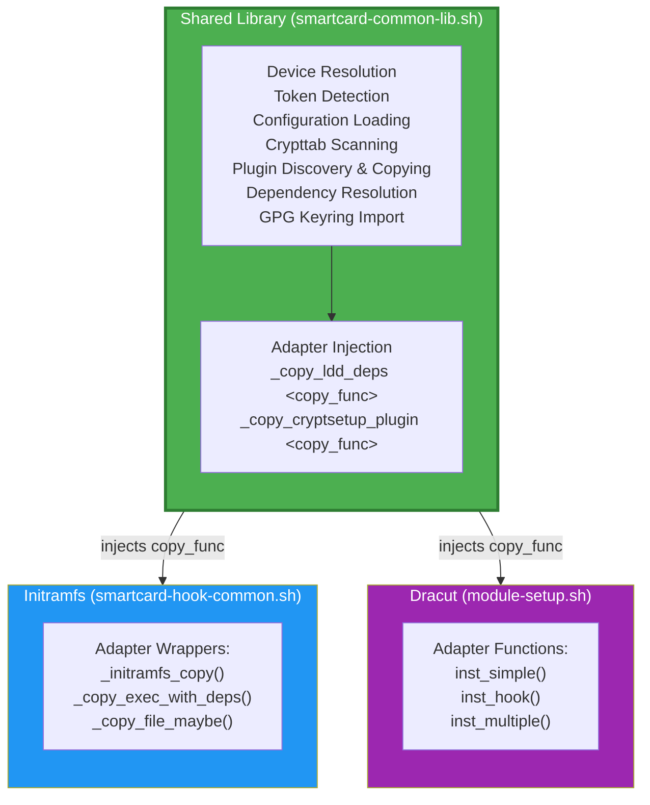

# Code Architecture Diagrams (Mermaid)

## System Overview

## Initramfs-Tools Build Time Flow

## Initramfs-Tools Boot Time Flow

## Dracut Module Installation Flow

```mermaid
graph TD
    dracut_cmd["dracut -f --add smartcard-root"] --> check["check()"]
    check --> require_crypto["require_binaries cryptsetup"]
    require_crypto --> depends["depends()"]
    depends --> return_crypt["return: crypt"]
    
    return_crypt --> install["install()"]
    install --> inst_lib["inst_simple smartcard-common-lib.sh"]
    inst_lib --> hook1["inst_hook pre-mount 01<br/>smartcard-root-common.sh"]
    hook1 --> hook2["inst_hook pre-mount 10<br/>smartcard-root-token-detection.sh"]
    hook2 --> hook3["inst_hook pre-mount 20<br/>smartcard-root-tpm2.sh"]
    hook3 --> hook4["inst_hook pre-mount 21<br/>smartcard-root-fido2.sh"]
    hook4 --> hook5["inst_hook pre-mount 22<br/>smartcard-root-pkcs11.sh"]
    hook5 --> hook6["inst_hook pre-mount 23<br/>smartcard-root-gpg.sh"]
    hook6 --> hook7["inst_hook cleanup 99<br/>smartcard-root-cleanup.sh"]
    
    hook7 --> installkernel["installkernel()"]
    installkernel --> mods["instmods tpm, tpm_tis, tpm_crb<br/>instmods hid, hid_generic, hidraw"]
    
    mods --> initramfs["Generate /boot/initramfs-*.img"]
    initramfs --> done["Module ready for boot"]
    
    style check fill:#2196F3,color:#fff
    style install fill:#2196F3,color:#fff
    style installkernel fill:#2196F3,color:#fff
    style done fill:#4CAF50,color:#fff
```

## Dracut Boot Time Flow

```mermaid
graph TD
    boot["Kernel Boot"] --> pre_mount["Pre-Mount Stage"]
    
    pre_mount --> common["01-smartcard-root-common"]
    common --> detect["10-smartcard-root-token-detection"]
    detect --> load_config["_load_inclusion_config"]
    load_config --> resolve["_resolve_dev_hook"]
    resolve --> scan1["_has_token TPM2"]
    scan1 --> exp1["export SMARTCARD_HAS_TPM2_TOKEN=1<br/>if found"]
    
    exp1 --> scan2["_has_token FIDO2"]
    scan2 --> exp2["export SMARTCARD_HAS_FIDO2_TOKEN=1<br/>if found"]
    
    exp2 --> scan3["_has_token PKCS11"]
    scan3 --> exp3["export SMARTCARD_HAS_PKCS11_TOKEN=1<br/>if found"]
    
    exp3 --> scan4["_has_token GPG"]
    scan4 --> exp4["export SMARTCARD_HAS_GPG_TOKEN=1<br/>if found"]
    
    exp4 --> tpm2_hook["20-smartcard-root-tpm2"]
    tpm2_hook --> tpm2_check{"SMARTCARD_HAS<br/>_TPM2_TOKEN=1?"}
    tpm2_check -->|No| fido2_hook["21-smartcard-root-fido2"]
    tpm2_check -->|Yes| tpm2_wait["wait_for_tpm_device"]
    tpm2_wait --> tpm2_open["cryptsetup luksOpen<br/>--token-type systemd-tpm2"]
    tpm2_open --> tpm2_result{"Success?"}
    tpm2_result -->|Yes| mounted["Root mounted"]
    tpm2_result -->|No| fido2_hook
    
    fido2_hook --> fido2_check{"SMARTCARD_HAS<br/>_FIDO2_TOKEN=1?"}
    fido2_check -->|No| pkcs11_hook["22-smartcard-root-pkcs11"]
    fido2_check -->|Yes| fido2_open["cryptsetup luksOpen<br/>--token-type systemd-fido2"]
    fido2_open --> fido2_result{"Success?"}
    fido2_result -->|Yes| mounted
    fido2_result -->|No| pkcs11_hook
    
    pkcs11_hook --> pkcs11_check{"SMARTCARD_HAS<br/>_PKCS11_TOKEN=1?"}
    pkcs11_check -->|No| gpg_hook["23-smartcard-root-gpg"]
    pkcs11_check -->|Yes| pkcs11_open["cryptsetup luksOpen<br/>--token-type systemd-pkcs11"]
    pkcs11_open --> pkcs11_result{"Success?"}
    pkcs11_result -->|Yes| mounted
    pkcs11_result -->|No| gpg_hook
    
    gpg_hook --> gpg_check{"SMARTCARD_HAS<br/>_GPG_TOKEN=1?"}
    gpg_check -->|No| cleanup_stage["Cleanup Stage"]
    gpg_check -->|Yes| gpg_open["cryptsetup luksOpen<br/>--token-type gpg-token"]
    gpg_open --> gpg_result{"Success?"}
    gpg_result -->|Yes| mounted
    gpg_result -->|No| cleanup_stage
    
    mounted --> cleanup_stage
    cleanup_stage --> cleanup_hook["99-smartcard-root-cleanup"]
    cleanup_hook --> killgpg["killall gpg-agent scdaemon"]
    killgpg --> killpcscd["killall pcscd"]
    killpcscd --> boot_done["Boot continues to real root"]
    
    style detect fill:#9C27B0,color:#fff
    style tpm2_hook fill:#9C27B0,color:#fff
    style fido2_hook fill:#9C27B0,color:#fff
    style pkcs11_hook fill:#9C27B0,color:#fff
    style gpg_hook fill:#9C27B0,color:#fff
    style cleanup_hook fill:#9C27B0,color:#fff
    style mounted fill:#4CAF50,color:#fff
    style boot_done fill:#4CAF50,color:#fff
```

## Token Detection Hierarchy

## Code Reuse Across Systems

## Dependency Graph

## Shared vs Adapter-Specific Code

